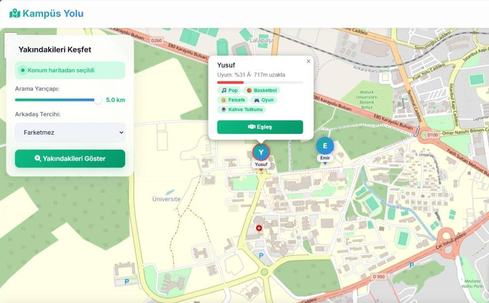
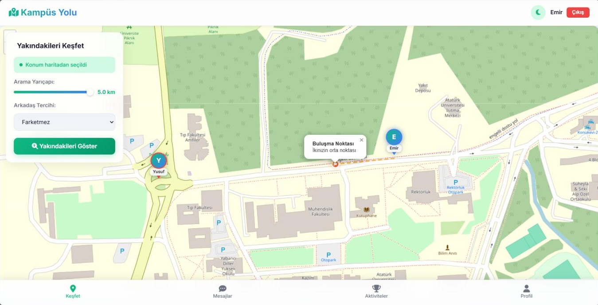
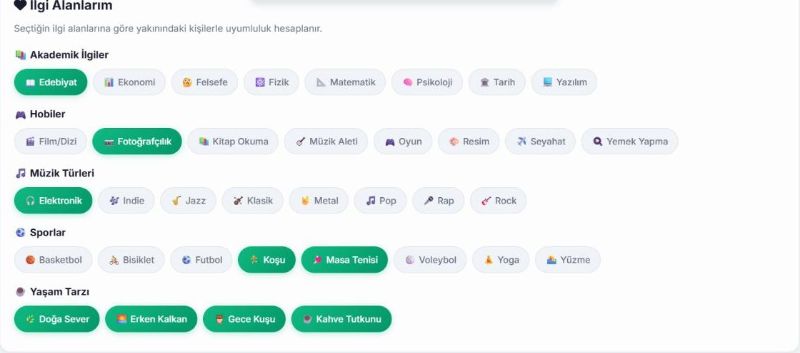
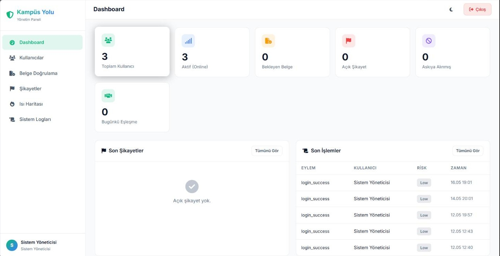
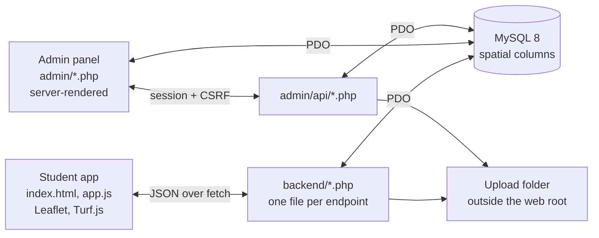

# Kampüs Yolu — Map-Based Campus Social App

A web application that helps university students find each other around campus. A student shares a location, sees who is nearby and how much they have in common, sends a match request, and once it is accepted the two get a meeting point halfway between them and a private chat. A separate admin panel covers moderation: document verification, complaints, warnings, suspensions and a heat map of where the app is used.

**Web Programming term project · Atatürk University · 2026** · PHP 8 · MySQL 8 (spatial) · vanilla JavaScript · Leaflet



## What it does

The idea is short walks and casual meet-ups between students who are already close to each other, with enough safeguards that meeting a stranger from the same campus feels reasonable.

1. **Register** with an e-mail address and, optionally, upload a document (for example a student certificate) to get a verified account.
2. **Pick interests** from 36 options in five groups: music, sports, academic, hobbies and lifestyle.
3. **Share a location**, either from the device or by clicking a point on the map.
4. **Discover** students within a chosen radius, each shown with a compatibility score and the interests you share.
5. **Match.** The other person accepts or rejects the request.
6. **Meet and talk.** An accepted match shows the midpoint between the two as a meeting spot and opens a chat.
7. **Stay safe.** Any user can be blocked or reported; administrators review reports and documents.

| Meeting point between two matched users | Interest selection |
|---|---|
|  |  |

## Features

### Discovery and matching
- Location from the browser's geolocation (continuously updated) or picked by hand on the map.
- Search radius from 500 m to 5 km and an optional gender preference.
- Only users who updated their location in the last 10 minutes are listed, nearest first, at most 20.
- Blocked users are hidden in both directions.
- **Compatibility score**: shared interests divided by the union of both users' interests (Jaccard similarity), as a percentage.
- Match requests can only be accepted or rejected by the person who received them.
- The midpoint of the two locations is stored with the match and drawn on the map (Turf.js on the client).

### Messaging
- Chat is available only inside an accepted match and stops working if either side blocks the other.
- Messages up to 1000 characters, read flags and an unread counter.
- The chat and the nearby list refresh every 3 seconds.

### Profile and safety
- Display name, gender, interests and a profile photo.
- Block and unblock users; report a user in one of five categories with a written description.
- Optional document upload; every document approved by an administrator raises the user's trust level (up to 3), and trust level 2 marks the account as verified.
- Warnings sent by administrators are shown to the user on the messages page.
- Account deletion with a reason, removing the user's matches and messages with it.
- Light and dark theme.

### Admin panel
- **Dashboard**: total and active users, pending documents, open complaints, suspended accounts, today's matches, latest activity.
- **Users**: search and filter, suspend, delete, grant or revoke the admin role, send a warning with a severity level.
- **Document review**: approve or reject uploaded documents with a note.
- **Complaints**: each report moves through open → investigating → resolved or dismissed, with an admin note.
- **Heat map**: where users have been, from the location history, filterable by period and time of day.
- **System logs**: admin logins, failed login attempts and every admin action, each with a risk level.



### Security measures
- Passwords hashed with `password_hash` (bcrypt); passwords need 8+ characters with upper case, lower case and a digit.
- Database access through PDO prepared statements with emulation turned off.
- **Login throttling**: five failed attempts from one IP address within 15 minutes lock further attempts (HTTP 429).
- **Admin area**: session cookies set to `HttpOnly` and `SameSite=Strict`, session ID regeneration, a CSRF token required by every admin action that changes data, HTML escaping in the views and restrictive response headers.
- **Uploads**: size limits (2 MB photos, 5 MB documents), the real file type is checked with `finfo` and by magic bytes, files get random names, are stored outside the web root and are served only through PHP.
- **Housekeeping**: scheduled MySQL events delete location history older than 30 days and logs older than 90 days.

## How it is built



1. **The database does the geography.** Locations are stored as `POINT SRID 4326` columns. Distances are calculated in SQL with `ST_Distance_Sphere`, so the radius filter, the ordering and the block filter are a single query.
2. **One PHP file per endpoint.** Each file validates its input, runs its queries and returns JSON. `http.php` and `db.php` hold the shared helpers.
3. **Two interfaces, one database.** Students use a single-page interface driven by `app.js`. The admin panel is rendered on the server and protected by a PHP session.
4. **Polling instead of sockets.** The client asks for new messages and nearby users every 3 seconds, which keeps the backend stateless and easy to host on a plain Apache + PHP stack.

### Data model

| Table | Holds |
|---|---|
| `users` | account, role, location (`POINT`), status, trust level, suspension flag |
| `interests`, `user_interests` | the interest catalogue and each user's selection (many-to-many) |
| `matches` | the two users, midpoint (`POINT`), compatibility score, status |
| `messages` | chat messages of a match with read flags |
| `blocked_users` | who blocked whom |
| `complaints` | reports with category, status and admin note |
| `user_documents` | uploaded documents and their review status |
| `admin_warnings` | warnings sent to users |
| `location_history` | location samples for the heat map (spatial index) |
| `system_logs` | audit trail with risk levels |
| `deletion_reasons` | why accounts were deleted |

### API overview

| Area | Endpoints (`backend/`) |
|---|---|
| Account | `register.php`, `login.php`, `update_profile.php`, `upload_profile_pic.php`, `get_avatar.php`, `delete_account.php` |
| Discovery | `get_interests.php`, `update_location.php`, `get_nearby_users.php` |
| Matching | `create_match.php`, `accept_match.php`, `reject_match.php`, `get_matches.php` |
| Messaging | `send_message.php`, `get_messages.php` |
| Safety | `block_user.php`, `unblock_user.php`, `get_blocked_users.php`, `submit_complaint.php`, `upload_document.php`, `get_warnings.php` |
| Admin (`admin/api/`) | `user_action.php`, `send_warning.php`, `review_document.php`, `view_document.php`, `update_complaint.php`, `get_heatmap_data.php` |

## Getting started

**Requirements**
- PHP 8 with the `pdo_mysql`, `fileinfo` and `mbstring` extensions
- MySQL 8.0 or newer. The schema uses MySQL's `POINT SRID 4326` column syntax, so MariaDB (the database bundled with XAMPP) is not supported as it is.
- Apache (for example WampServer) or PHP's built-in web server
- Internet access in the browser for the map tiles and the libraries loaded from CDNs

**Set up**

1. Clone the repository.
   ```
   git clone https://github.com/EmirAkay-007/kampus_yolu.git
   cd kampus_yolu
   ```
2. Create the database. The second script adds the admin-panel tables and the clean-up events; it switches on the MySQL event scheduler, so run it with an administrative account.
   ```
   mysql -u root -p < backend/schema.sql
   mysql -u root -p < backend/migration_v3_admin.sql
   ```
   `backend/migration_v2.sql` is only needed to upgrade a database created from an older version of the schema.
3. Edit `backend/config.php`: database user and password, and two folders for uploaded photos and documents. Use absolute paths that end with a path separator and, preferably, lie outside the web root.
4. Start the application from the project folder and open <http://localhost:8000/>.
   ```
   php -S localhost:8000
   ```
   With WampServer, place the folder under `www` and open `http://localhost/kampus_yolu/` instead.
5. To get an administrator, register an account in the interface and then promote it:
   ```sql
   UPDATE kampus_yolu.users SET role = 'admin' WHERE email = 'you@example.com';
   ```
   Signing in with that account opens the admin panel.

The steps above were verified on PHP 8.3 and MySQL 8.0.

## Project structure

```
index.html, app.js, style.css    student interface (single page)
backend/
├── config.php                   database and upload settings
├── db.php, http.php             shared connection and JSON helpers
├── *.php                        one file per API endpoint
├── schema.sql                   core tables and the interest catalogue
└── migration_v*.sql             later additions (admin tables, events)
admin/
├── *.php                        dashboard, users, documents, complaints, heat map, logs
├── api/                         JSON endpoints used by the admin pages
└── inc/                         session and CSRF checks, security helpers, logging
docs/screenshots/                images used in this README
```

## Known limitations

This is a course project that runs on a local server. Its current shortcomings, stated openly:

- **The student API is not authenticated.** Endpoints trust the `userId` sent by the browser; there is no session or token behind it, so anyone who can reach the API can act as any user. Only the admin area is session-protected. This is the first thing to fix before any real deployment.
- CORS is open to every origin, and several error responses include the underlying exception message.
- Suspending a user is recorded and shown in the admin panel but is not yet enforced at login or in the API.
- The login throttle identifies clients by the `X-Forwarded-For` header when it is present, which a client can forge.
- The "Sign in with Google" button is a placeholder.
- The risk-scoring helpers in `admin/inc/security.php` (complaints, blocks, trust level, suspension) are written but not yet shown in the admin panel.
- On the statistics page, total matches and average compatibility are real; distance walked and CO₂ saved are static sample values.
- Updates rely on 3-second polling; there is no push channel, and a chat loads at most 100 messages.
- The interface is in Turkish only, the libraries are loaded from CDNs, and there are no automated tests.

## Roadmap

- Session-based authentication for the student API, with ownership checks on every endpoint.
- Enforce suspensions; restrict CORS; return generic error messages.
- Show the per-user risk score and the list of risky users in the admin panel.
- Real activity statistics computed from completed matches.
- WebSocket or server-sent events for chat and nearby updates.
- English interface and a single consolidated schema file.

## Team

| | Role |
|---|---|
| **Hüseyin Emir Akay** ([@EmirAkay-007](https://github.com/EmirAkay-007)) | Backend: API endpoints, authentication, security |
| **Yusuf İslam İnan** | Frontend: map integration, responsive design, interface flows |

Project management, visual design and style decisions were shared.

## License

No license has been chosen yet. The code is published for reference, and all rights remain with the authors.
